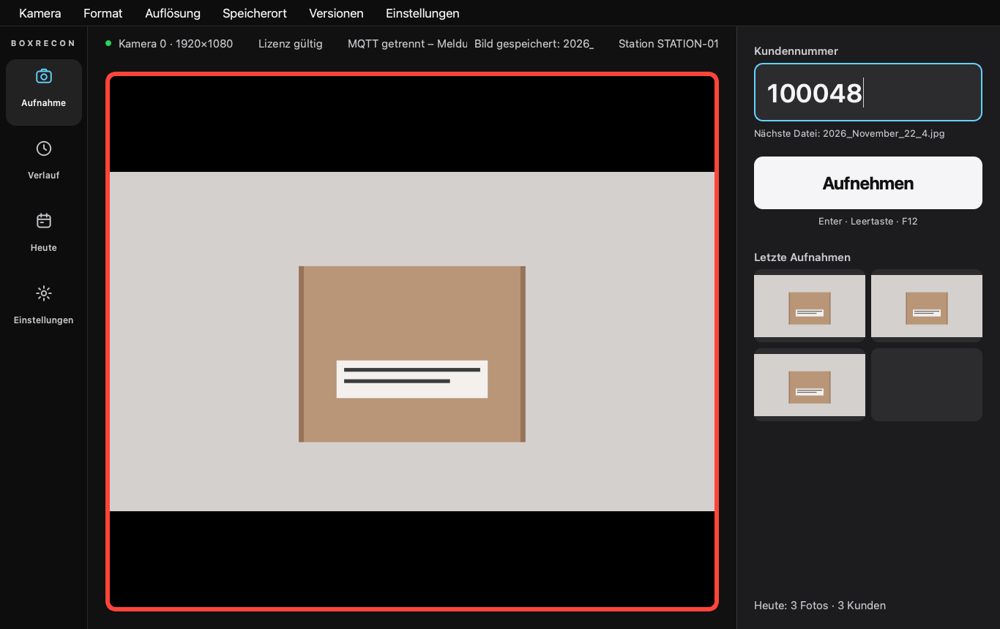
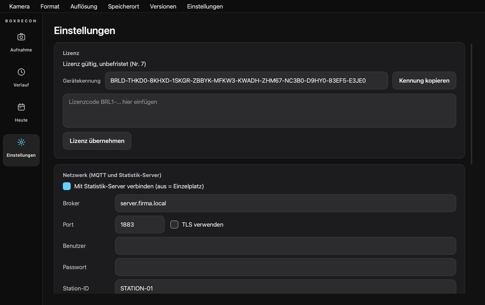
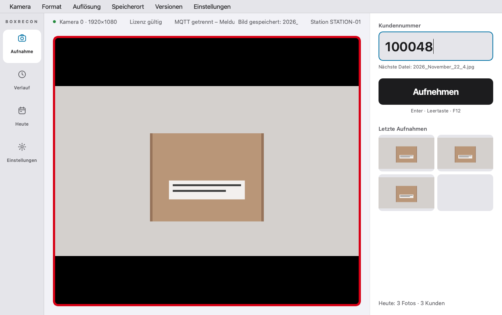
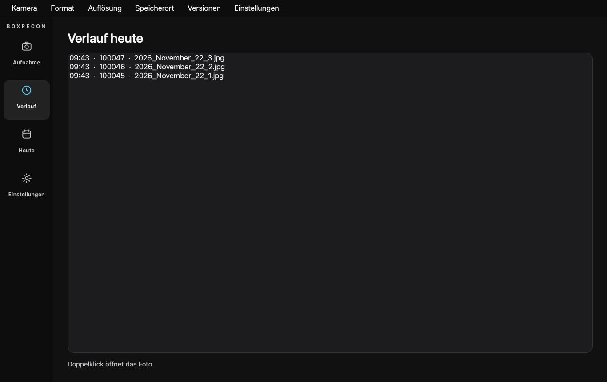
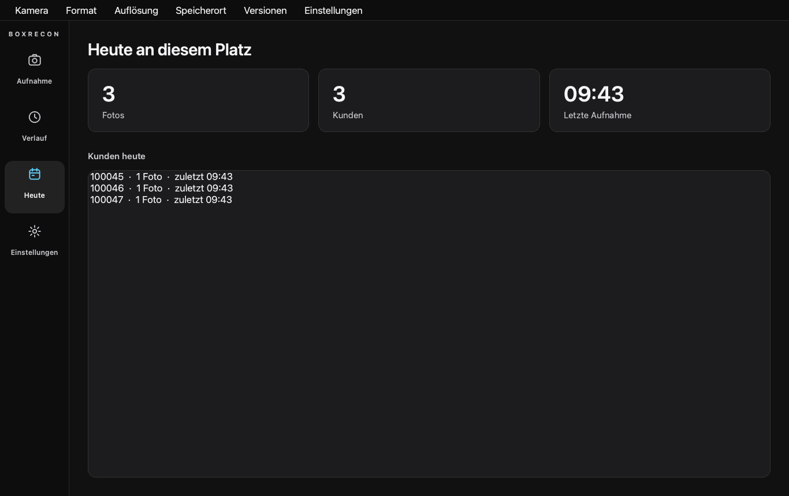

# BoxReconLight

**BoxReconLight** ist eine Kamera-Station zur Aufnahme und Verwaltung von Fotos mit Kundennummer –
gedacht für den Waren- und Paketein- und -ausgang. Scannen oder tippen Sie die Kundennummer, lösen Sie
per Taste aus, und das Foto wird automatisch benannt und abgelegt. Optional melden mehrere Stationen an
einen Statistik-Server.

Dies ist die **Download- und Anleitungsseite**. Der Quellcode ist privat.



---

## Inhalt

- [Download](#download)
- [Installation und erster Start](#installation-und-erster-start)
- [Lizenz eintragen](#lizenz-eintragen)
- [Die Oberfläche](#die-oberfläche)
- [Alle Funktionen im Detail](#alle-funktionen-im-detail)
- [Tastenkürzel](#tastenkürzel)
- [Netzwerk und Statistik-Server (optional)](#netzwerk-und-statistik-server-optional)
- [Wo liegen Einstellungen und Fotos?](#wo-liegen-einstellungen-und-fotos)
- [Problemlösung](#problemlösung)

---

## Download

Die aktuelle Version finden Sie immer unter **[Releases](../../releases/latest)**.

| System | Datei | Hinweis |
|---|---|---|
| **macOS** (Apple-Chip M1/M2/M3 …) | `BoxReconLight-<Version>-macos-arm64.dmg` | Siehe erster Start unten |
| **Linux** (x86_64, glibc 2.36+, z. B. Ubuntu 23.04+/Debian 12+) | `BoxReconLight-<Version>-linux-x86_64.tar.gz` | Zusatzpakete nötig, siehe unten |
| **Windows** (10/11, 64-bit) | `BoxReconLight-<Version>-windows.zip` | Ordner zusammen lassen, siehe unten |

> Die Programme sind nicht von Apple/Microsoft signiert. Beim ersten Start warnt das Betriebssystem –
> das ist normal, siehe [Problemlösung](#problemlösung).

---

## Installation und erster Start

### macOS

1. Die `.dmg` öffnen und **BoxReconLight** in den Ordner **Programme** ziehen.
2. Beim **ersten** Start: im Finder mit **Rechtsklick → Öffnen**, dann noch einmal **Öffnen**. Danach
   startet die App künftig per Doppelklick. (Ein normaler Doppelklick beim ersten Mal wird blockiert,
   weil die App nicht von Apple beglaubigt ist.)
3. Beim ersten Start fragt macOS nach dem **Kamerazugriff** → **Erlauben**. Ohne Erlaubnis bleibt oben
   „Kamera wird gestartet …“ stehen.

### Linux

1. Zusatzpakete installieren (Ubuntu/Debian):
   ```bash
   sudo apt install libxcb-cursor0 libxkbcommon-x11-0 libegl1 libgl1
   ```
2. Entpacken und starten:
   ```bash
   tar xzf BoxReconLight-*-linux-x86_64.tar.gz
   ./BoxReconLight/BoxReconLight
   ```
3. Für den Kamerazugriff muss Ihr Benutzer in der Gruppe `video` sein
   (`sudo usermod -aG video $USER`, danach neu anmelden).

### Windows (10/11, 64-bit)

1. Die `BoxReconLight-<Version>-windows.zip` herunterladen und **entpacken** (Rechtsklick → „Alle extrahieren …“).
2. Den entstandenen Ordner **BoxReconLight** an einen festen Ort legen (z. B. `C:\BoxReconLight`) und **komplett
   zusammen lassen** – `BoxReconLight.exe` startet nur mit dem Ordner `_internal` daneben.
3. **BoxReconLight.exe** per Doppelklick starten. Beim ersten Mal meldet sich Windows (SmartScreen) mit
   „Der Computer wurde durch Windows geschützt“ → **Weitere Informationen** → **Trotzdem ausführen**.
4. Für die Kamera ggf. unter *Einstellungen → Datenschutz → Kamera* den Zugriff für Apps erlauben.

> Tipp: Für einen Startmenü-Eintrag eine Verknüpfung zu `BoxReconLight.exe` erstellen – die Datei selbst aber
> im Ordner lassen.

---

## Lizenz eintragen

Ohne gültige Lizenz zeigt die Station das Livebild, **speichert aber keine Fotos**. So schalten Sie frei:

1. **Einstellungen** (Navigationsleiste links) → Bereich **Lizenz**.
2. **Kennung kopieren** – das ist die an diesen Rechner gebundene Gerätekennung `BRLD-…`.
3. Die Kennung an **Byte Commander®** senden und den Lizenzcode `BRL1-…` zurückbekommen.
4. Den Code in das Feld einfügen (Groß-/Kleinschreibung, Leerzeichen und Zeilenumbrüche sind egal) und
   **Lizenz übernehmen** drücken. Die Station ist **sofort ohne Neustart** freigeschaltet.



> Die Kennung ändert sich bei Austausch der Hauptplatine oder Neuinstallation des Betriebssystems –
> dann wird ein neuer Code benötigt.

---

## Die Oberfläche

Links die Navigationsleiste mit vier Seiten: **Aufnahme**, **Verlauf**, **Heute**, **Einstellungen**.
Oben die Menüleiste für alle Einstellungen. Umschalten zwischen **hell** und **dunkel** jederzeit über
*Einstellungen → Darstellung hell/dunkel* (oder den Knopf „Hell / Dunkel“).

| Aufnahme (dunkel) | Aufnahme (hell) |
|---|---|
|  |  |

**Aufnahme** ist der Arbeitsplatz: großes Livebild, rechts Kundennummer, Vorschau des nächsten Dateinamens,
der große Auslöser und die letzten vier Fotos. Ganz unten die Tageszahl (Fotos/Kunden).

| Verlauf | Heute |
|---|---|
|  |  |

**Verlauf** listet alle Aufnahmen des Tages; Doppelklick öffnet das Foto. **Heute** zeigt Fotos und Kunden
des Tages, die Uhrzeit der letzten Aufnahme und die Kundenliste mit Fotoanzahl.

---

## Alle Funktionen im Detail

### Aufnehmen
- Auslösen per **Knopf „Aufnehmen“**, per **Enter** im Kundennummernfeld (ideal für Handscanner), per
  **Leertaste** (außerhalb des Felds) oder **F12**.
- Das Speichern läuft im Hintergrund – der Auslöser ist sofort wieder bereit.
- Nach erfolgreicher Aufnahme erscheint 1 Sekunde ein **roter Rahmen** um das Livebild.

### Kundennummer
- Rechts eintippen oder mit dem Handscanner einlesen (Scanner, der mit Enter abschließt).
- Maximal 20 Zeichen; erlaubt sind `A–Z a–z 0–9 _ -`, andere Zeichen werden bereinigt. Leeres Feld → Ordner
  bzw. Name „Unbekannt“.
- Die **Beschriftung** des Felds lässt sich ändern: *Einstellungen → Kundennummer-Label ändern*.

### Kamera
- **Menü Kamera → Kamera auswählen**: Kamera per Index wählen.
- **Kameras automatisch erkennen**: prüft Index 0–6 und zeigt die gefundenen Kameras mit Auflösung.
- **Auflösung** (Menü): **AUTO**, **4K**, **Full HD**, **HD**. AUTO versucht die beste unterstützte Stufe.

### Bildformat und Qualität
- **Format** (Menü): **JPG**, **PNG**, **TIFF**.
- **JPG-Qualität** 1–100: *Einstellungen → JPG-Qualität setzen*.

### Speicherort und Dateinamen
- **Speicherort** frei wählbar: *Speicherort wählen* (Knopf oder Menü).
- **Namensschema A** (nach Datum):
  `…/<Jahr>/<Monat>/<TT_MM_JJJJ>/<JJJJ_Monat_TT_Zähler>.<ext>` – pro Tag ein Ordner, fortlaufender Zähler,
  kein Überschreiben nach Neustart.
- **Namensschema E** (nach Kunde):
  `…/<Kundennummer>/<JJJJ-MM-TT_HHMMSS>.<ext>` – je Kunde ein Ordner, Dateiname aus Datum und Uhrzeit.
- **Kundennummer als Präfix** (Menü *Versionen*): stellt die Kundennummer zusätzlich vor den Dateinamen.
  Dann ist die Kundennummer Pflicht.
- Die **Vorschau** „Nächste Datei“ zeigt live, wie das nächste Foto heißen wird.

### Anzeige nach der Aufnahme (Menü *Versionen → Speicher-Version*)
- **Combat Ready**: zeigt durchgehend das Livebild, nach der Aufnahme 2 Sekunden das gespeicherte Foto.
- **Tactical Withdraw**: zeigt nach der Aufnahme das zuletzt gespeicherte Foto stehend an.

### Metadaten (optional)
*Einstellungen → Metadaten schreiben*: legt je Foto eine **JSON-Datei** mit allen Angaben an und schreibt
zusätzlich eine zentrale **`capture-log.csv`** im Speicherort. Abschaltbar.

### Weitere
- **Vollbild** umschalten (Menü Kamera).
- **Über**-Dialog mit Version und Hersteller.
- **Statusleiste** oben: Kamerazustand, Lizenzstatus, MQTT-Status, Station, Meldungen.

---

## Tastenkürzel

| Taste | Wirkung |
|---|---|
| **Enter** (im Kundennummernfeld) | Aufnahme auslösen (Handscanner) |
| **Leertaste** (außerhalb des Felds) | Aufnahme auslösen |
| **F12** | Aufnahme auslösen |
| Doppelklick auf einen Eintrag im **Verlauf** | Foto öffnen |

---

## Netzwerk und Statistik-Server (optional)

Ohne Server arbeitet jede Station als **Einzelplatz** wie oben beschrieben. Im Firmennetz können mehrere
Stationen an einen **Statistik-Server** melden, der eine Live-Webseite zeigt: welche Station online ist,
welcher Kunde gerade bearbeitet wird, Kunden und Fotos je Platz, ein Tagesdiagramm, Foto-Links und einen
CSV-Export.

Eine Station anbinden unter **Einstellungen → Netzwerk**:
- **Mit Statistik-Server verbinden** einschalten, **Broker** = Adresse des Servers, **Port** 1883.
- **Station-ID** eindeutig vergeben.
- **Fotos**: `lokal` (bleiben auf der Station, der Server holt sie bei Bedarf) oder `server` (jedes Foto
  wird zusätzlich hochgeladen; dann **Server-URL** eintragen).
- **Zugangsschlüssel** = der Token des Servers.
- Zusätzlich lässt sich eine Station per **MQTT** fernauslösen – auch mit Kundennummer, z. B. aus einer SPS.

Fällt der Server aus, speichert die Station weiter und sendet Meldungen und Uploads später nach.

> Der Statistik-Server wird vom Administrator getrennt eingerichtet (Windows/Linux, mit eingebautem
> MQTT-Broker). Bei Bedarf stellt Byte Commander® die Server-Anleitung bereit.

---

## Wo liegen Einstellungen und Fotos?

| System | Einstellungen (`settings.ini`) | Standard-Speicherort der Fotos |
|---|---|---|
| **Windows** | neben dem Programm; bei Schreibschutz unter `%APPDATA%\BoxReconLight` | selbst gewählt |
| **macOS** | `~/Library/Application Support/BoxReconLight` | `~/Pictures/BoxReconLight` |
| **Linux** | neben dem Programm; sonst `~/.config/boxreconlight` | selbst gewählt |

Der Speicherort lässt sich jederzeit über *Speicherort wählen* ändern und gilt sofort.

---

## Problemlösung

| Situation | Lösung |
|---|---|
| macOS: „… kann nicht geöffnet werden, da Apple es nicht überprüfen kann“ | Rechtsklick auf die App → **Öffnen** → **Öffnen**. Nur beim ersten Mal nötig. |
| Windows: „Der Computer wurde durch Windows geschützt“ (SmartScreen) | **Weitere Informationen** → **Trotzdem ausführen**. |
| Oben steht dauerhaft „Kamera wird gestartet …“ | Kamerazugriff erlauben (macOS: Systemeinstellungen → Datenschutz → Kamera; Linux: Gruppe `video`); andere Kamera über *Kameras erkennen* wählen. |
| „Speichern gesperrt“ / kein Foto wird gespeichert | Es fehlt eine gültige Lizenz – siehe [Lizenz eintragen](#lizenz-eintragen). |
| Lizenz: **Tippfehler** | Code Gruppe für Gruppe vergleichen. |
| Lizenz: **Anderes Gerät** | Der Code gehört zu einer anderen Gerätekennung. Die Kennung **dieses** Rechners senden. |
| Lizenz: **Unbekannter Schlüssel** | BoxReconLight aktualisieren oder den Hersteller fragen. |
| Lizenz: **Abgelaufen** | Abo-Lizenz verlängern (nach Ablauf 30 Tage Übergangsfrist mit Hinweis). |

---

© Byte Commander® · [byte-commander.de](https://byte-commander.de)
Nutzung nur mit gültiger Lizenz. Quellcode privat; hier liegen nur die fertigen Programme und diese Anleitung.
